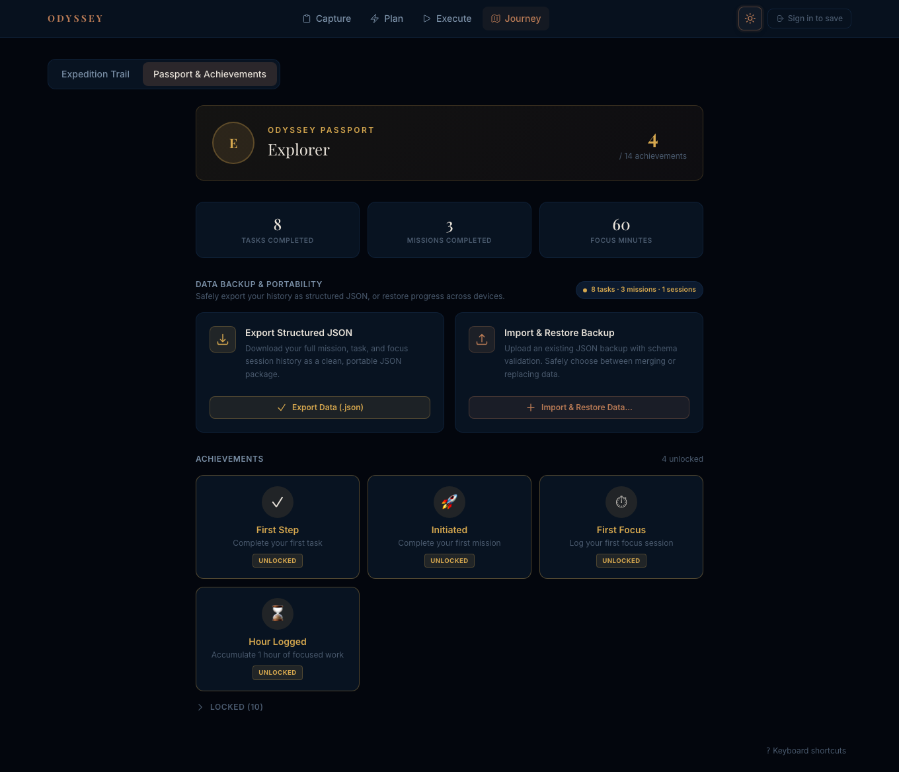
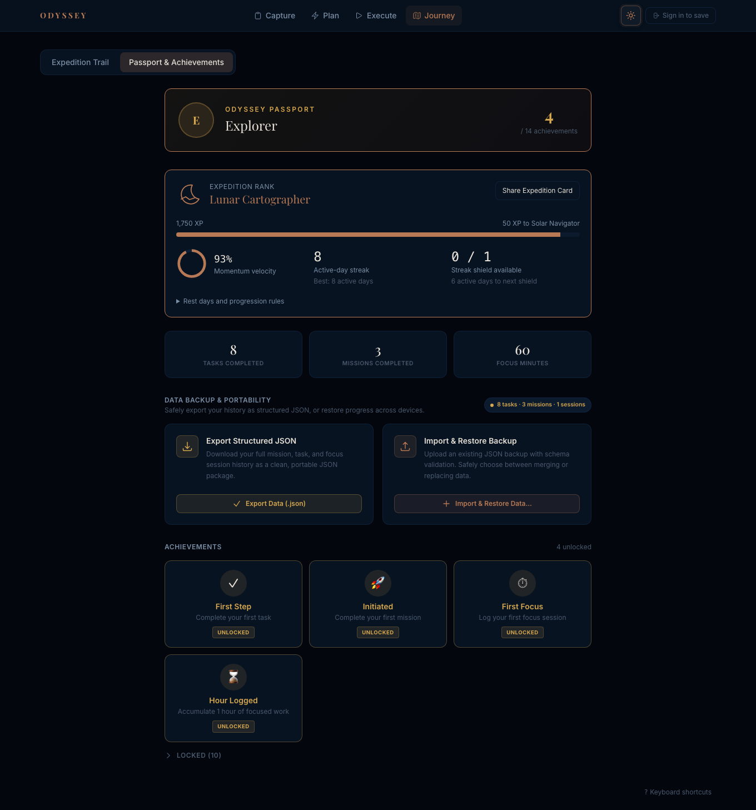
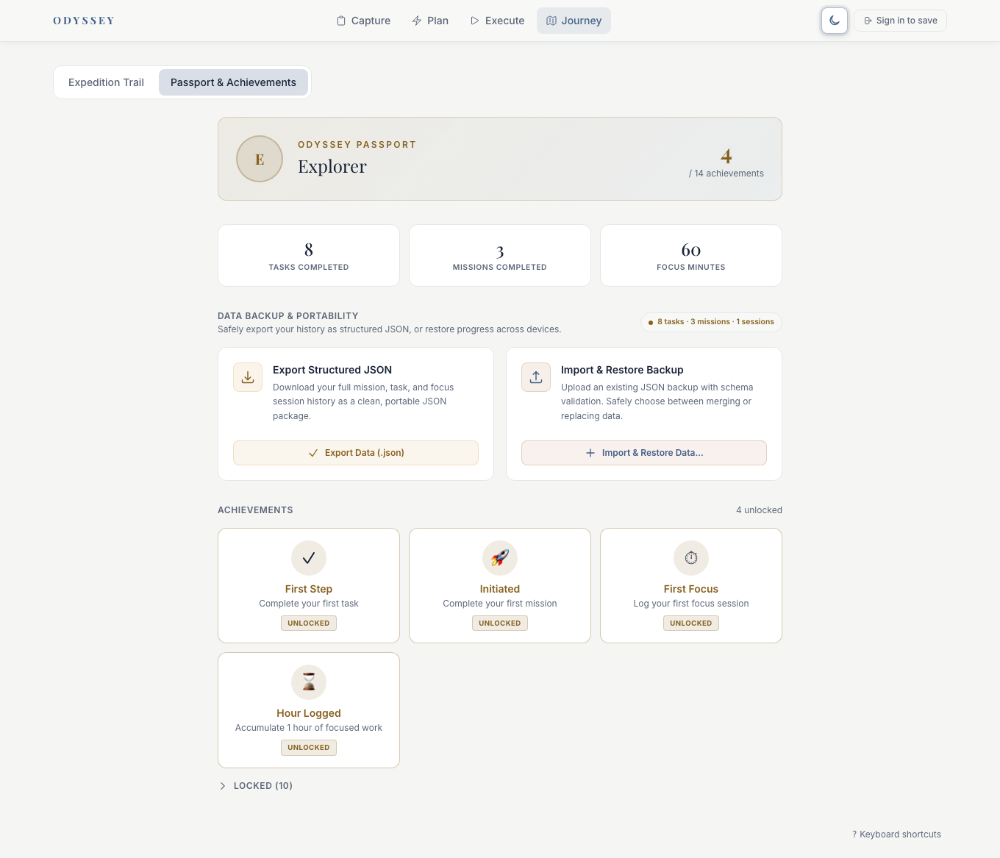
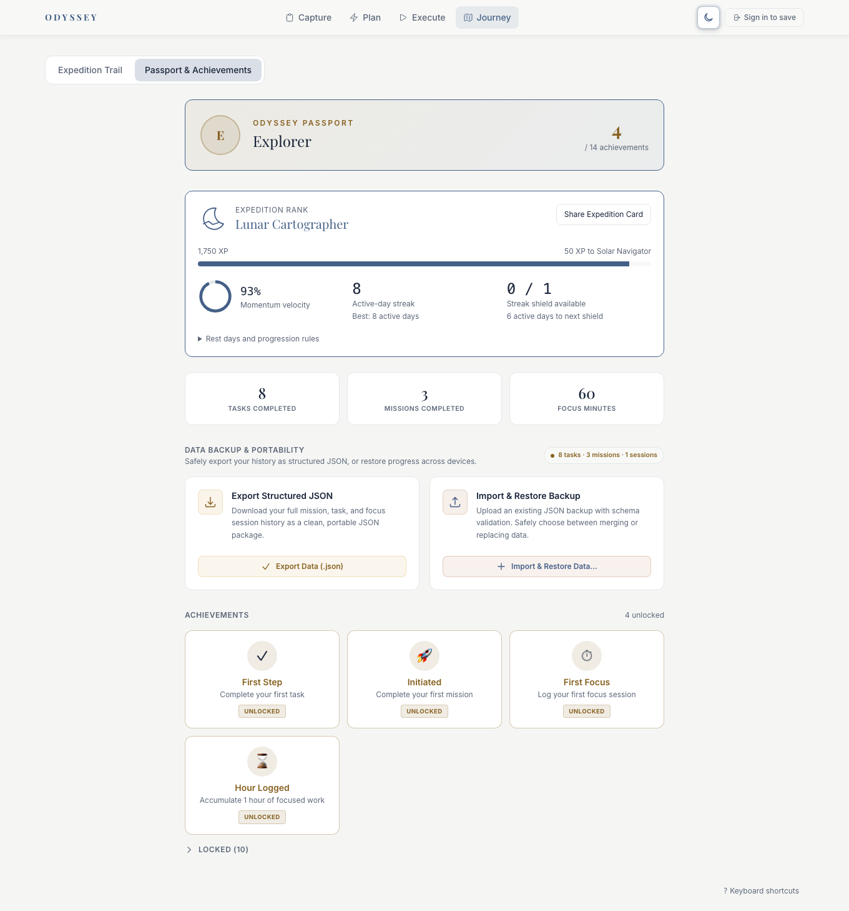
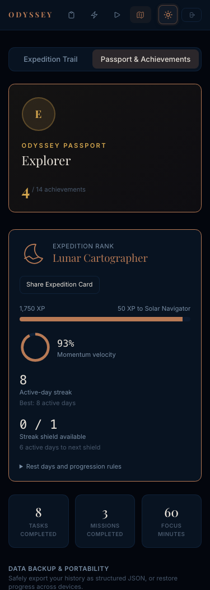
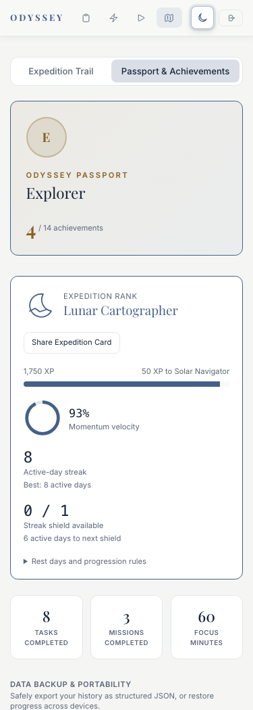
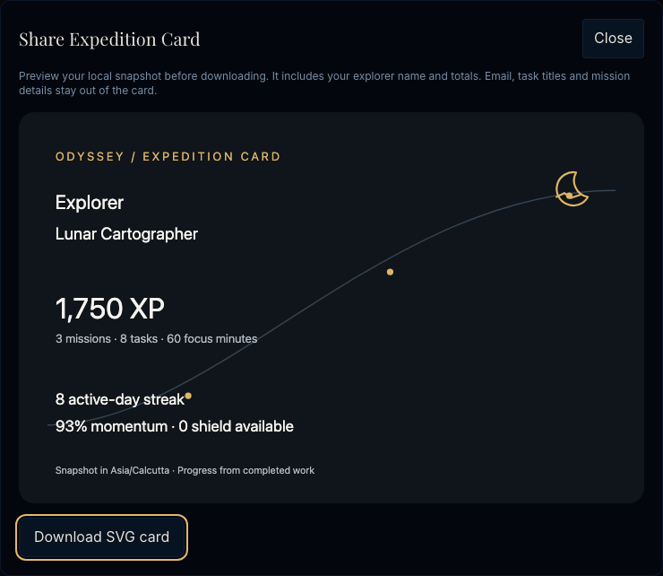
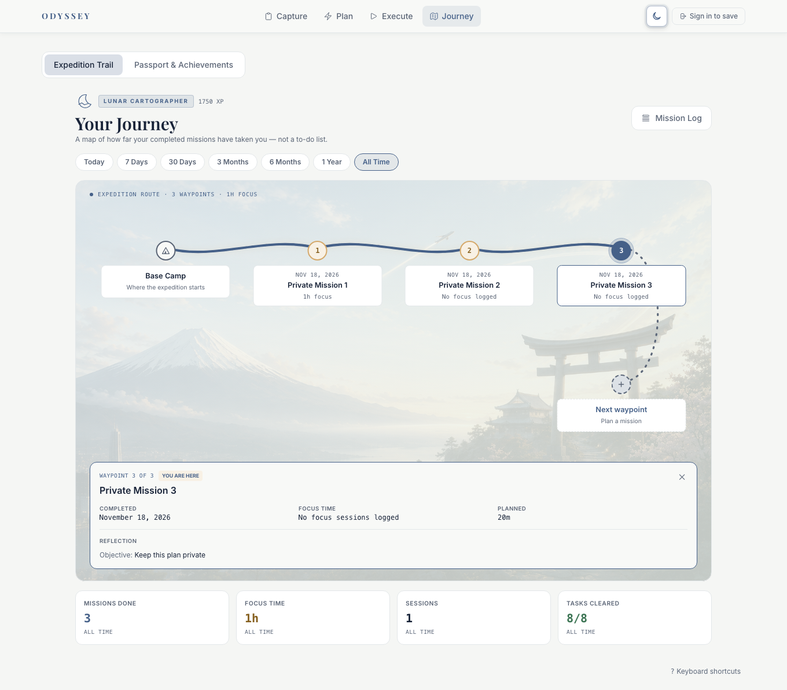

# Expedition progression review

Before captures use actual main `f242a300`; after captures use the normal production build of `8f327967`. All records are fictional, seeded through Odyssey's existing supported anonymous/localStorage mode. Authentication, services, Vite configuration and dependencies are unchanged. No Supabase project or production database was used.

- Full suite: 464 tests, versus 438 on main (26 new progression cases).
- Production build passes. Lint exits 0 with the same 11 normalized warnings as the exact base; no new warning. Main and feature both report existing bundle-size and ineffective-dynamic-import advisories.
- Actual development and production browser flows passed for 1,750 XP / Lunar Cartographer / 8 active days / one previously consumed shield; all five rank bands and empty history were also rendered.
- Rest-day settings persist through reload. Simulated elapsed time decays momentum while leaving earned XP unchanged. Trail horizons, mission history, achievements and backup controls remain present.
- Native Tab/Shift+Tab focus wrapping, blocked app shortcuts while the dialog is open, Escape/Close focus return, real SVG download (960x600 decoded preview), privacy fields and download failure/recovery passed. Normal and reduced motion were checked.
- New progression content is contained at 320, 375, 430, 850 and 1360px. At 320px the existing global sign-in header creates a 333px document on BOTH main and feature. This unrelated baseline overflow is unchanged; the new panel fits the viewport. At the larger tested widths the document is contained.
- No browser page errors or failed requests. The app's existing Google Fonts assets loaded normally; external Vercel telemetry was omitted in the local browser fixture. No unexpected external API requests.

| Before | After |
| --- | --- |
|  |  |
|  |  |

| Mobile dark | Mobile light |
| --- | --- |
|  |  |

